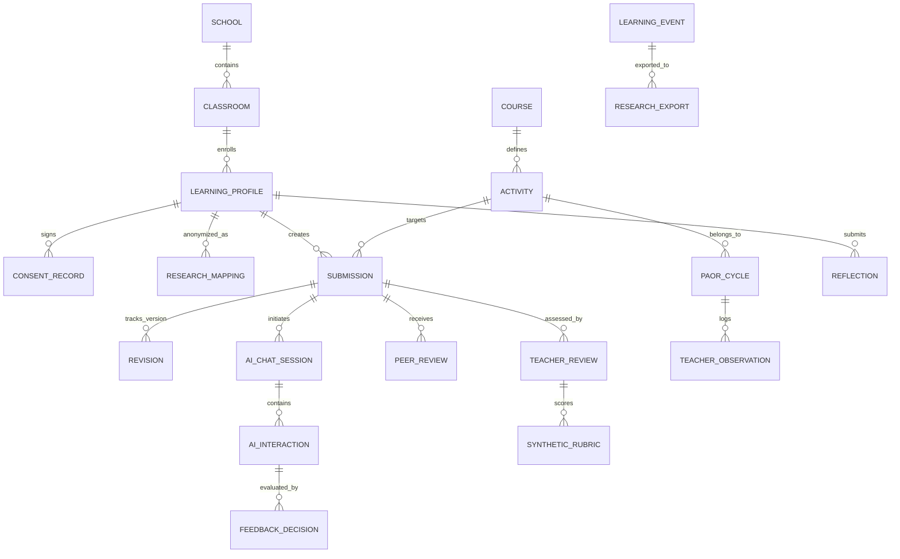

# รายงานการตรวจประเมินระบบ Learn OS เชิงวิชาการและการวิจัยในชั้นเรียน
## (Learn OS Research Alignment & Operational Environment Audit Report)

**วันที่ประเมิน:** 28 สิงหาคม 2569 (28 August 2026)  
**สถานะการประเมิน:** 🏁 Completed (Full Research Audit)  
**โครงการวิจัย:** การพัฒนาความสามารถในการคิดสังเคราะห์ผ่านการเขียนตอบและความฉลาดรู้ปัญญาประดิษฐ์ของนักเรียนชั้นมัธยมศึกษาปีที่ 4 เรื่องระบบนิเวศและการถ่ายทอดพลังงาน โดยใช้การจัดการเรียนรู้แบบสืบสอบเชิงโต้แย้งร่วมกับ AI เป็นโค้ชการเขียน  
**บริบทวิจัย:** วิชาชีววิทยา มัธยมศึกษาปีที่ 4 (จำนวน 57 คน, 2 ห้องเรียน) | รูปแบบวิจัย: วิจัยปฏิบัติการในชั้นเรียน (Classroom Action Research: CAR) ตามวงจร PAOR จำนวน 2 วงรอบ  
**วัตถุประสงค์ของการตรวจสอบ:** ประเมินความพร้อมเชิงปฏิบัติการของระบบ Learn OS ในฐานะ **"สภาพแวดล้อมวิจัยเชิงปฏิบัติการ (Operational Research Environment)"** เพื่อพิสูจน์ว่าระบบสามารถสร้าง จัดเก็บ และส่งออก **"หลักฐานเชิงประจักษ์ที่ตรวจสอบย้อนกลับได้ (Traceable & Auditable Empirical Evidence)"** ตามข้อกำหนดของระเบียบวิธีวิจัยและมาตรฐานการประเมินของคณะกรรมการผู้เชี่ยวชาญ/อาจารย์ที่ปรึกษาวิทยานิพนธ์

---

## 1. Research-to-System Traceability Matrix
*(ตารางวิเคราะห์ความสอดคล้องระหว่างข้อกำหนดงานวิจัยและคุณลักษณะของระบบ Learn OS)*

| Research Requirement | Required Evidence | Learn OS Feature / Component | Current Implementation in Codebase | Status | Gap Analysis | Recommended Change |
| :--- | :--- | :--- | :--- | :--- | :--- | :--- |
| **1. กลุ่มเป้าหมาย ม.4 (57 คน, 2 ห้องเรียน)** | ข้อมูลแยกห้องเรียน (Class A/B) รายชื่อและรหัสนักเรียน 57 คน | Multi-class & Student Identity Scope | `classes`, `memberships`, `learning_profiles` ใน `005_phase9_education_model.sql`, UI Roster ใน `teacher-roster-view.tsx` | **PARTIAL** | Schema รองรับ Class/Student แต่หน้า Workbench นักเรียน (`student-workbench.tsx`) ยังใช้ Mock Dropdown / Hardcoded `demo-student-01` ไม่มี Class Context Switcher สำหรับ 2 ห้องเรียนจริง | เชื่อมโยง Login/Select Class & Student ID เข้ากับ `classes` Table จริงในฐานข้อมูลเพื่อแยกกลุ่มตัวอย่าง 2 ห้องเรียนอย่างสมบูรณ์ |
| **2. วงจร PAOR 2 วงรอบ (Cycle 1 & Cycle 2)** | หลักฐานแยก Cycle 1 (Act-Observe-Reflect) และ Cycle 2 ที่ปรับปรุง | PAOR Cycle Engine & Tagging | ไม่มี Cycle Field ใน Activity/Submission/Event | **NOT IMPLEMENTED** | ระบบยังไม่มี Data Field `cycle_number` (Cycle 1 vs Cycle 2) ไม่สามารถแยกวิเคราะห์ความก้าวหน้าระหว่างวงรอบที่ 1 และ 2 ในเชิงสถิติได้ | เพิ่ม `cycle: 1 \| 2` ใน Schema ของ `activities`, `submissions`, `learning_events` และตัวกรองใน Teacher Dashboard |
| **3. กระบวนการ ADI 7 ขั้นตอน** | ลำดับการทำกิจกรรม 7 Phase ต่อเนื่อง บันทึกเวลาและสถานะ | ADI 7-Phase Stepper & State Machine | `AdiStepper.tsx`, `adiWorkflow.ts`, Phase Components (Phase 1–7) | **PASS** | มี Stepper และ State Transition ครบ 7 Phase (`orientation` ➔ `identification` ➔ `investigation` ➔ `argument` ➔ `peer_review` ➔ `revision` ➔ `reflection`) | รักษากลไกนี้ไว้ และเพิ่มการล็อกลำดับ (Phase Locking) ไม่ให้นักเรียนข้าม Phase โดยไม่ส่งงาน |
| **4. การคิดสังเคราะห์ 4 มิติ (Synthetic Thinking)** | บันทึกหลักฐาน: (1) คัดเลือกข้อมูล (2) เชื่อมโยง (3) สังเคราะห์ภาษาตนเอง (4) ตอบตรงประเด็น | Synthetic Rubric & Writing Workspace | CER Forms ใน `Phase4Argumentation.tsx`, `Phase6Revision.tsx`, Rubric ใน `teacher-review-dashboard.tsx` | **PARTIAL** | ระบบใช้แบบจำลอง Claim-Evidence-Reasoning (CER) ซึ่งครอบคลุมบางส่วน แต่ยังไม่แยก Rubric ชัดเจนตาม 4 มิติของการคิดสังเคราะห์ตามนิยามงานวิจัย | ปรับโครงสร้าง Rubric ทั้งในฝั่ง AI Evaluator และครู ให้ประเมินแยก 4 มิติของการคิดสังเคราะห์โดยตรง |
| **5. การเขียน Draft 1 อิสระก่อนใช้ AI** | ข้อความ Draft 1 ที่พิมพ์เสร็จและประทับเวลาก่อนเปิด AI Chat | Draft Freeze & Idempotent Submission | `Phase4Argumentation.tsx` (`/api/sessions` v1) | **PARTIAL** | นักเรียนสามารถเปิด Socratic Mini-Chat ได้ขณะที่ยังพิมพ์ Draft 1 ไม่เสร็จสมบูรณ์ ทำให้เสี่ยงต่อการที่นักเรียนให้ AI คิดนำก่อนเขียน Draft แรก | บังคับลำดับ: ต้องกด "บันทึก Draft 1 ฉบับตั้งต้น" ให้ระบบ Freeze ข้อมูลลงฐานข้อมูลก่อน จึงจะปลดล็อกปุ่มเรียก AI Coach |
| **6. AI เป็นโค้ชการเขียน (ห้ามเฉลยคำตอบ)** | AI Response Log ที่เป็นคำถามเชิง Socratic, ไม่มีข้อความสรุปคำตอบ | Socratic Guardrails & Safety Policy | `education-policy.ts`, `isSocraticMessage`, System Prompts ใน `coach.ts` | **PASS** | มีกฎเหล็ก `no_direct_answer`, `approved_context_only`, บังคับ System Prompt ภาษาไทย และตรวจสอบ Socratic Question Markers | ยกระดับ Guardrail ให้ตรวจจับกรณี AI เผลอเขียนย่อหน้าสังเคราะห์คำตอบสำเร็จรูป |
| **7. บทบาท AI Evaluator และ AI Opponent** | บันทึกแยก: (1) Feedback ตรวจสอบ CER (2) บทสนทนาท้าทายสมมติฐาน | Dual AI Persona Engine | ปัจจุบันมีเฉพาะ AI Socratic Coach ทั่วไปใน `coach.ts` และ `socratic-coach-chat.tsx` | **NOT IMPLEMENTED** | ไม่มีบทบาท "AI Opponent" ที่ทำหน้าที่ตั้งประเด็นคัดค้าน/โต้แย้ง (Counter-argument) เพื่อบีบให้นักเรียนปกป้องหรือทบทวนเหตุผล | พัฒนา AI Opponent Prompt Mode ใน Phase 4/5 และบันทึก Log แยกบทบาท `ai_evaluator` กับ `ai_opponent` |
| **8. พฤติกรรมความฉลาดรู้ AI (AI Literacy Logs)** | บันทึก Chat Log จริง: Prompt, Follow-up, การตรวจสอบ, เหตุผลยอมรับ/ปฏิเสธ | Comprehensive Interaction Logging | `/api/coach/chat/route.ts`, Event `hint_requested`, `ai_feedback_received` | **PARTIAL** | มีการบันทึก User Message และ Coach Reply ลงใน `learning_events` แต่ยังขาด UI ที่ให้นักเรียนระบุ "เหตุผลการยอมรับ/ปฏิเสธคำแนะนำของ AI" | เพิ่มแบบฟอร์ม "Feedback Decision & Justification" ใน Phase 6 เพื่อเก็บหลักฐาน Critical Evaluation ของนักเรียน |
| **9. ห่วงโซ่หลักฐาน Draft 1 ➔ Chat ➔ Final Draft** | ประวัติการพัฒนาการเขียน (Evolution Diff) ที่จับคู่กันสมบูรณ์ | Versioning & Authorship Tracker | `submissions` (v1/v2), `revisions`, `authorship.ts` | **PARTIAL** | ฐานข้อมูลเก็บ Submission v1 และ v2 แยกกัน แต่หน้าจอครูและ Export ยังไม่มีการเปรียบเทียบแบบ Side-by-Side Diff ให้เห็นจุดที่เปลี่ยนชัดเจน | สร้างหน้าจอ Side-by-Side Diff Viewer ใน Teacher Dashboard แสดง Draft 1 vs AI Suggestion vs Final Draft |
| **10. การส่งออกข้อมูลวิจัย (Research Dataset Export)** | ไฟล์ CSV/JSON แยกตารางนิรนาม (De-identified) วิเคราะห์ใน SPSS/R | Research Export Endpoint | `/api/research/export/route.ts`, `export.ts` | **PARTIAL** | Export ปัจจุบันดึงเฉพาะ Raw Event Logs กว้างๆ ยังไม่รวมตารางสรุปรายคน (Wide Format) ที่ประกอบด้วย Pre/Post, Draft 1, Draft 2, Rubric, Chat Count | พัฒนา Research Data Exporter ให้ได้ตาราง CSV พร้อมวิเคราะห์สถิติ paired t-test / Wilcoxon signed-rank ทันที |

---

## 2. การตรวจสอบลำดับขั้นการเรียนรู้ของนักเรียน (Student Learning Workflow Audit)

การวิเคราะห์ความสามารถของ Learn OS ในการควบคุม (Enforce) และเก็บบันทึกหลักฐานตามลำดับขั้นตอน A ถึง L:

```
[A. สถานการณ์ชีววิทยา] ➔ [B. ระบุปัญหา] ➔ [C. คัดเลือกหลักฐาน] ➔ [D. เชื่อมโยงความสัมพันธ์]
          ↓
[E. พิมพ์ Draft 1 ด้วยตนเอง] ➔ [F. ส่งและ Freeze Draft 1] ➔ [G. รับ AI Socratic Feedback]
          ↓
[H. ประเมิน Feedback] ➔ [I. ตัดสินใจ ยอมรับ/ปฏิเสธ] ➔ [J. ระบุเหตุผลการตัดสินใจ]
          ↓
[K. ปรับปรุง Final Draft] ➔ [L. สะท้อนคิดและประเมิน AI Literacy]
```

### ตารางตรวจสอบกระบวนการเรียนรู้ 12 ขั้นตอน (Stages A – L)

| ขั้นตอนการเรียนรู้ (Stage) | Learn OS สนับสนุนหรือไม่? | ระบบบันทึกหลักฐานหรือไม่? (Evidence Log) | ครูสามารถตรวจสอบได้หรือไม่? | ข้อมูลส่งออกเพื่อการวิจัยได้หรือไม่? | สถานะ |
| :--- | :--- | :--- | :--- | :--- | :--- |
| **A. รับบทความ/สถานการณ์ระบบนิเวศ** | รองรับผ่าน `Phase1Orientation.tsx` (แสดงสายใยอาหาร 2 เส้น และคำถามนำ) | บันทึก `context_viewed` / `activity_selected` | ตรวจสอบได้ว่าเปิดดูเวลาใด | มีใน Event Log | **PASS** |
| **B. ระบุสิ่งที่โจทย์ถาม/ปัญหา** | รองรับผ่าน `Phase2Identification.tsx` (กรอกปัญหาและตัวแปร) | บันทึกใน Local State & Step Navigation | ครูดูข้อมูลตัวแปรได้ใน Snapshot | ส่งออกเป็น JSON Payload ได้ | **PASS** |
| **C. เลือกสรรข้อมูล/หลักฐานเชิงประจักษ์** | รองรับผ่าน `Phase3Investigation.tsx` (ตารางข้อมูลประชากร/พลังงาน) และช่อง Evidence ใน Phase 4 | บันทึก Organism ที่คลิก และข้อความใน `CerResponse.evidence` | ครูเห็นข้อความ Evidence ใน Submission Card | ส่งออกเป็นคอลัมน์ Evidence ได้ | **PASS** |
| **D. อธิบายความสัมพันธ์ระหว่างข้อมูล** | รองรับผ่านช่อง Reasoning ใน Phase 4 (เชื่อมโยงกฎ 10% และสายใยอาหาร) | บันทึกใน `CerResponse.reasoning` | ครูเห็นข้อความ Reasoning ใน Submission Card | ส่งออกเป็นคอลัมน์ Reasoning ได้ | **PASS** |
| **E. เขียน Draft 1 อย่างเป็นอิสระ** | รองรับผ่าน Form CER ใน `Phase4Argumentation.tsx` | บันทึกเป็น Submission Version 1 | ครูเห็นข้อความ Draft 1 เต็มรูปแบบ | ส่งออก Version 1 ได้ | **PASS** |
| **F. ส่ง Draft 1 เข้าสู่ระบบ** | รองรับผ่านปุ่ม "ส่งข้อโต้แย้งและรับ Feedback" (`/api/sessions`) | บันทึก Event `student_submitted` + Timestamp | ครูเห็นเวลาส่งและ Response Time | ส่งออก Timestamp และ Version ได้ | **PASS** |
| **G. AI ให้ Feedback ชวนคิด (ไม่เฉลย)** | รองรับผ่าน `generateCoachFeedback` และ Socratic Chat | บันทึก Event `ai_feedback_received` พร้อม Citations | ครูเห็นคำถามที่ AI ถามนักเรียนใน Dashboard | ส่งออกข้อความ Feedback ได้ | **PASS** |
| **H. นักเรียนประเมินความถูกต้องของ Feedback** | รองรับบางส่วน (นักเรียนอ่านข้อความในบล็อก Feedback และใน Chat) | ยังไม่มีช่องบันทึกการประเมิน Feedback แยกเฉพาะ | ครูเห็นเฉพาะบทสนทนาโต้ตอบใน Chat | ยังไม่มีคะแนนประเมิน Feedback ส่งออก | **PARTIAL** |
| **I. นักเรียนตัดสินใจ ยอมรับ/ปฏิเสธ Feedback** | ยังไม่รองรับ (นักเรียนข้ามไปแก้ใน Phase 6 ได้โดยตรงโดยไม่ต้องระบุ) | **ไม่มีการบันทึกค่า Accept / Reject Action** | **ครูไม่สามารถดูได้ว่านักเรียนเลือกรับข้อไหน** | **ไม่มีข้อมูลใน Export** | **FAIL** |
| **J. นักเรียนอธิบายเหตุผลของการตัดสินใจ** | ยังไม่รองรับ (ไม่มีกล่องข้อความให้ระบุเหตุผลเชิงวิพากษ์) | **ไม่มีการบันทึก Justification Text** | **ครูไม่เห็นกระบวนการคิดในการคัดกรอง AI** | **ไม่มีข้อมูลใน Export** | **FAIL** |
| **K. เขียนคำตอบฉบับสมบูรณ์ (Final Draft)** | รองรับผ่าน `Phase6Revision.tsx` (`/api/sessions` บันทึก Version 2) | บันทึก Submission Version 2 + Event `student_revised` | ครูเห็นข้อความ Final Draft ใน Submission Card | ส่งออก Version 2 ได้สมบูรณ์ | **PASS** |
| **L. สะท้อนคิดกระบวนการเรียนรู้และการใช้ AI** | รองรับผ่าน `Phase7Reflection.tsx` (บันทึกคะแนนประเมินตนเองและข้อคิด) | บันทึกใน Table `reflections` + Event `reflection_completed` | ครูเห็นผลสะท้อนคิดใน Analytics/Roster | ส่งออกคะแนนและข้อความสะท้อนคิดได้ | **PASS** |

> [!IMPORTANT]
> **จุดบกพร่องวิกฤตของ Workflow (Critical Workflow Gaps):**
> ขั้นตอน **I (ตัดสินใจ ยอมรับ/ปฏิเสธ)** และ **J (อธิบายเหตุผล)** เป็น "หัวใจสำคัญของการพิสูจน์ AI Literacy และการคิดสังเคราะห์" เพื่อแสดงให้ผู้ทรงคุณวุฒิเห็นว่านักเรียนไม่ได้เชื่อ AI แบบหลับหูหลับตา (Blind Acceptance) หรือคัดลอกข้อความ AI มาวาง หากไม่มีฟิลด์จัดเก็บหลักฐานขั้น I และ J งานวิจัยจะไม่สามารถแสดงข้อมูลเชิงคุณภาพยืนยัน Critical Evaluation Behavior ได้

---

## 3. การตรวจสอบหลักฐานการคิดสังเคราะห์ (Synthetic Thinking Audit)

การคิดสังเคราะห์ในการวิจัยนี้ถูกกำหนดไว้ 4 มิติหลัก ระบบ Learn OS มีความพร้อมในการจัดเก็บและวัดผลดังนี้:

```
มิติที่ 1: การเลือกสรรข้อมูลที่เกี่ยวข้อง (Selecting Relevant Information)
มิติที่ 2: การเชื่อมโยงความสัมพันธ์ของข้อมูล (Connecting Information)
มิติที่ 3: การสังเคราะห์และเรียบเรียงด้วยภาษาของตนเอง (Reconstructing in Own Language)
มิติที่ 4: การตอบตรงประเด็นและสมเหตุสมผล (Answering Directly and Appropriately)
```

### การเก็บบันทึกองค์ประกอบหลักฐาน (Artifact Preservation)

| องค์ประกอบหลักฐาน (Evidence Artifact) | การจัดเก็บใน Learn OS | ตำแหน่งในโค้ด / ฐานข้อมูล | ความสมบูรณ์ |
| :--- | :--- | :--- | :--- |
| **1. Source / บทความสถานการณ์** | บันทึกใน Context ของ Activity | `activities.context` ใน `activities.ts` & DB | 100% |
| **2. ข้อมูลหลักฐานที่นักเรียนเลือก** | บันทึกในช่อง Evidence ของ CER | `submissions.content.evidence` | 100% |
| **3. เหตุผลและการเชื่อมโยง** | บันทึกในช่อง Reasoning ของ CER | `submissions.content.reasoning` | 100% |
| **4. ข้อเขียน Draft 1** | บันทึกเป็น Submission Version 1 | `submissions` where `version = 1` | 100% |
| **5. ข้อเสนอแนะจาก AI (Feedback)** | บันทึกใน Event และ AI Interaction Log | `ai_interactions.response`, `learning_events` | 100% |
| **6. การตอบสนองต่อ AI Feedback** | บันทึกในประวัติ Chat Log | `ai_interactions`, `hints` | 70% (ขาด Accept/Reject Tag) |
| **7. ข้อเขียน Final Draft** | บันทึกเป็น Submission Version 2 | `submissions` where `version = 2` | 100% |
| **8. ประวัติการปรับปรุง (Revision History)** | บันทึกทุก Version ใน Revisions Table | `revisions` table (`submission_id`, `version`) | 100% |
| **9. การประเมินและข้อคิดเห็นของครู** | บันทึกคะแนนและคอมเมนต์ครู | `teacher_reviews` table | 100% |
| **10. คะแนน Rubric แยกมิติ** | บันทึก Claim, Evidence, Reasoning (1–4) | `teacher_reviews.rubric_scores` | 60% (ยังเป็น CER ไม่ใช่ 4 มิติสังเคราะห์) |
| **11. ลำดับเวลาและ Timestamp** | ประทับเวลา ISO 8601 ทุก Event | `learning_events.occurred_at` | 100% |

### การเปรียบเทียบ Draft 1 และ Final Draft (Comparative Analysis)
*   **ความสามารถปัจจุบัน:** ระบบจัดเก็บ Version 1 และ Version 2 ไว้ในฐานข้อมูลอย่างถูกต้อง สามารถ Query ขึ้นมาดูได้
*   **ข้อจำกัดที่พบ:** ในหน้าจอ Teacher Review Dashboard ครูต้องกด Toggle ดูทีละอัน และยังไม่มี **"Side-by-Side Visual Diff"** ที่ทำไฮไลต์ข้อความส่วนที่มีการสังเคราะห์ข้อมูลใหม่เพิ่มขึ้น ทำให้อาจารย์ผู้ตรวจงานวิจัยไม่สามารถมองเห็นวิวัฒนาการของความคิดสังเคราะห์ได้อย่างรวดเร็ว

---

## 4. การตรวจสอบความฉลาดรู้ปัญญาประดิษฐ์ (AI Literacy Audit)

งานวิจัยนี้กำหนดให้ **"AI Chat Log จริงเป็นหลักฐานสำคัญ (Critical Empirical Evidence)"** แทนที่จะพึ่งพาเพียงแบบสอบถาม Self-Report Likert Scale

```
[Student Prompt] ➔ [Context Supplied] ➔ [AI Socratic Reply] ➔ [Student Challenge/Verification] ➔ [Accept/Reject Decision & Justification]
```

### การบันทึกพฤติกรรมการใช้ AI เชิงประจักษ์ (Behavioral AI-Use Capture)

| มิติตัวชี้วัด AI Literacy | Learn OS ตรวจจับและบันทึกได้หรือไม่? | รายละเอียดข้อมูลในระบบ | ความเพียงพอต่องานวิจัย |
| :--- | :--- | :--- | :--- |
| **1. Student Prompt & Question Quality** | บันทึกผ่าน `POST /api/coach/chat` | จัดเก็บข้อความ Prompt จริงของนักเรียนทุกรอบใน Event `hint_requested` | **เพียงพอ** (นำไปทำ Qualitative Coding ได้) |
| **2. Context Supplied to AI** | บันทึกงาน CER ที่ส่งไปพร้อมกับ Chat | แนบ Draft CER ปัจจุบันของนักเรียนเข้าไปใน Context ของ Request | **เพียงพอ** |
| **3. AI Coach Response** | บันทึกคำตอบของ AI Coach ทุกข้อความ | จัดเก็บใน Event `ai_feedback_received` พร้อม Model Telemetry | **เพียงพอ** |
| **4. Student Follow-up Questions** | บันทึกลำดับ Turn-taking ใน Chat | จัดเก็บประวัติ Multi-turn Chat ต่อเนื่องใน `history` Array | **เพียงพอ** |
| **5. Student Challenge / Questioning AI** | จัดเก็บได้หากนักเรียนพิมพ์โต้แย้งใน Chat | ปรากฏใน Chat Log แตาระบบยังไม่มี Flag อัตโนมัติระบุว่าเป็น "Challenge Turn" | **พอใช้** (ต้องใช้มนุษย์ Code ข้อมูล) |
| **6. Verification of AI Information** | ยังไม่มีฟังก์ชันให้นักเรียนกดบันทึกการตรวจสอบ | ไม่มี Log เฉพาะเรื่องการ Cross-check แหล่งข้อมูล | **ยังไม่เพียงพอ** |
| **7. Acceptance / Rejection of AI Feedback** | ยังไม่มีปุ่มหรือโครงสร้างข้อมูลรองรับ | นักเรียนเลือกทำเองในใจแล้วแก้ Draft 6 ไม่มี Log แยก | **ไม่เพียงพอ (ต้องเพิ่ม)** |
| **8. Reasoning for Accept / Reject** | ยังไม่มีกล่องข้อความรองรับ | ไม่มีข้อมูลในระบบ | **ไม่เพียงพอ (ต้องเพิ่ม)** |
| **9. Evidence of Non-Copying (Authorship)** | มีการคำนวณ `copySimilarityToPrompt` | มีโมดูล `authorship.ts` ตรวจสอบความเร็วและข้อความซ้ำ | **เพียงพอในระดับพื้นฐาน** |
| **10. Timestamps & Sequence of Interactions** | บันทึก Timestamp ระดับมิลลิวินาที | มี `occurredAt` และ `responseTimeSeconds` ในทุก Transaction | **สมบูรณ์** |

### ความพร้อมในการส่งออก Chat Log เพื่อการวิเคราะห์เชิงคุณภาพ (Qualitative Thematic Coding)
*   **สถานะปัจจุบัน:** ระบบสามารถดึง Chat Events ออกมาได้ในรูปแบบ JSON Payload กว้างๆ
*   **ข้อแนะนำปรับปรุง:** ต้องสร้าง Export Format เฉพาะสำหรับ Chat Log ที่เรียงลำดับ `[SessionID, StudentID, TurnNumber, Timestamp, Role, Content, AI_Model, Tokens, Latency]` เพื่อให้ผู้วิจัยนำเข้าโปรแกรมวิเคราะห์ข้อมูลเชิงคุณภาพ เช่น MAXQDA, NVivo หรือจัดทำตาราง Content Analysis ในภาคผนวกวิทยานิพนธ์ได้ทันที

---

## 5. การตรวจสอบความปลอดภัยและหลักการสอนของ AI Coach (AI Coach Safety & Pedagogical Audit)

การวิจัยนี้กำหนดให้ **AI ทำหน้าที่เป็นโค้ชชวนคิด (Thinking Coach) และกลไกสะท้อนความคิด (Feedback Mechanism) ห้ามเขียนคำตอบแทนนักเรียนอย่างเด็ดขาด**

```
❌ Answer Generator: "คำตอบคือ เมื่อประชากรงูลดลง หนูจะเพิ่มเป็น 1,250 ตัว..." (ผิดหลักการวิจัย)
✅ Socratic Coach: "ลองสังเกตตารางใน Phase 3 ดูสิครับว่า เมื่อจำนวนผู้ล่าลดลง เกิดอะไรขึ้นกับประชากรหนู และส่งผลต่อพืชอย่างไร?" (ถูกต้อง)
```

### การวิเคราะห์ความเสี่ยงของ Prompt & Guardrail ในโค้ดปัจจุบัน

1.  **System Prompt Verification (`src/lib/ai/coach.ts` บรรทัดที่ 59–61, 201–209):**
    *   *ข้อกำหนด:* บังคับกฎ 5 ข้อชัดเจน: (1) ถามนำแบบ Socratic (2) อ้างอิงเฉพาะ Approved Context (3) ห้ามเขียนคำตอบการบ้าน (4) กระตุ้นการเชื่อมโยง CER (5) สื่อสารภาษาไทยเชิงบวก
    *   *ผลการประเมิน:* **รัดกุมและตรงตามหลักการสอน (Pedagogically Sound)**
2.  **จุดอ่อนเชิงเทคนิคที่ตรวจพบใน Guardrail (`src/lib/safety/education-policy.ts`):**
    *   ฟังก์ชัน `isSocraticMessage()` (บรรทัดที่ 45–48) ตรวจสอบเพียงว่ามีคำใน `["?", "อย่างไร", "เพราะอะไร", "อะไรจะเกิดขึ้น", "ลองอธิบาย", "how", "why", "what"]` หรือไม่
    *   *ช่องโหว่ (Vulnerability):* หากโมเดล LLM เจนเนอเรตคำตอบสรุปแบบสมบูรณ์มา 3 ย่อหน้า แล้วตบท้ายประโยคสุดท้ายด้วย *"นักเรียนคิดว่าอย่างไรครับ?"* ฟังก์ชัน `isSocraticMessage()` จะตัดสินว่าเป็น `true` และปล่อยให้คำตอบหลุดไปถึงนักเรียนได้!
    *   *ความเสี่ยงต่องานวิจัย:* นักเรียนอาจนำคำตอบที่ AI สรุปให้ไปส่งเป็น Final Draft ซึ่งจะทำลายความเที่ยงตรงของการวัด "ความคิดสังเคราะห์ของนักเรียนเอง"

### สถาปัตยกรรม AI Coach ที่แนะนำให้ยกระดับ (Recommended Hardened Guardrail)

```typescript
// แนะนำให้เพิ่มการตรวจจับโครงสร้างความยาวและ Direct Answer Sentence Patterns
export function validateStrictSocraticResponse(message: string): boolean {
  const normalized = message.trim();
  // 1. ต้องไม่ยาวเกินไปจนกลายเป็นการเขียนสังเคราะห์แทน (ไม่เกิน 150 คำ / 600 ตัวอักษร)
  if (normalized.length > 650) return false;
  
  // 2. ต้องไม่มีประโยคเฉลยข้อสรุปเด็ดขาด
  const declarativeConclusions = ["สรุปได้ว่าคำตอบคือ", "คำตอบที่ถูกต้องคือ", "ข้อสรุปที่สมบูรณ์คือ"];
  if (declarativeConclusions.some(phrase => normalized.includes(phrase))) return false;
  
  // 3. ประโยคหลักต้องลงท้ายด้วยคำถามเชิงสืบเสาะ
  return questionMarkers.some(marker => normalized.includes(marker));
}
```

---

## 6. การตรวจสอบบทบาท AI Evaluator และ AI Opponent

ในกระบวนการ Argument-Driven Inquiry (ADI) การฝึกคิดสังเคราะห์ที่มีประสิทธิภาพสูงสุดต้องอาศัยการเผชิญกับ **"ข้อโต้แย้ง/การท้าทายสมมติฐาน (Counter-Argumentation)"**

```
┌────────────────────────────────────────┐     ┌────────────────────────────────────────┐
│             AI Evaluator               │     │              AI Opponent               │
├────────────────────────────────────────┤     ├────────────────────────────────────────┤
│ • ตรวจสอบความครบถ้วนของ Claim-E-R      │     │ • ท้าทายสมมติฐานหลัก (Assumptions)     │
│ • ชี้จุดที่ข้อมูลหลักฐานยังขาดหาย      │     │ • ยกสถานการณ์ขัดแย้ง (Counter-Example)  │
│ • ประเมินความสมเหตุสมผลเชิงตรรกะ       │     │ • บังคับให้นักเรียนต้อง "ปกป้อง/ปรับปรุง" │
│ • ให้คะแนนเชิงพัฒนาการ (Formative)    │     │ • จำลองเป็นเพื่อนร่วมอภิปรายเชิงวิชาการ│
└────────────────────────────────────────┘     └────────────────────────────────────────┘
```

*   **สถานะปัจจุบันใน Learn OS:**
    *   *AI Evaluator:* มีการทำงานบางส่วนใน `generateCoachFeedback` (ระบุ Target Dimension ที่ขาด เช่น `claim`, `evidence`, หรือ `reasoning`)
    *   *AI Opponent:* **ยังไม่มีการพัฒนาแยกบทบาท (NOT IMPLEMENTED)** ปัจจุบัน AI Coach ทำหน้าที่เป็นผู้ให้คำแนะนำแบบประนีประนอมฝ่ายเดียว
*   **ข้อเสนอแนะในการปรับปรุง:**
    *   สร้าง Prompt Template สำหรับ `AI_OPPONENT` ใน Phase 5/6 เช่น: *"หากนักเรียนอ้างว่างูลดลงทำให้หนูเพิ่มขึ้นเรื่อยๆ แล้วถ้าประชากรหนูเพิ่มจนพืชหมดระบบนิเวศ หนูจะยังเพิ่มขึ้นได้จริงหรือ? ลองอธิบายกลไกควบคุมสมดุลนี้ใหม่"*
    *   บันทึก Interaction แยก Column: `agent_role: 'evaluator' | 'opponent'` เพื่อใช้แสดงหลักฐานการฝึกทักษะการโต้แย้งทางวิทยาศาสตร์

---

## 7. การตรวจสอบการสนับสนุนการวิจัยเชิงปฏิบัติการในชั้นเรียน 2 วงรอบ (PAOR Cycle Audit)

งานวิจัยนี้ใช้ระเบียบวิธีวิจัย **Classroom Action Research (CAR) 2 Cycles** ตามกรอบ PAOR (Kemmis & McTaggart, 1988)

```
[CYCLE 1] ➔ Plan ➔ Act (Activity 1) ➔ Observe (Logs & Dashboard) ➔ Reflect (Teacher Notes)
    ↓ (การปรับปรุงแผนการสอนและระบบ Prompt)
[CYCLE 2] ➔ Revised Plan ➔ Act (Activity 2) ➔ Observe ➔ Reflect ➔ Final Synthesis
```

### การตรวจสอบความพร้อมของระบบต่อวงจร PAOR

| วงจร PAOR | กระบวนการวิจัย | หลักฐานที่ต้องใช้ในเล่มวิจัย | สิ่งที่ Learn OS บันทึกได้ในปัจจุบัน | สถานะ | สิ่งที่ต้องแก้ไขทันที |
| :--- | :--- | :--- | :--- | :--- | :--- |
| **Cycle 1: Plan** | กำหนดแผนจัดการเรียนรู้และ Approved Context กิจกรรมที่ 1 | เอกสารเนื้อหา, กิจกรรมสายใยอาหาร | มีใน `ecosystem-food-web-01` (`activities.ts`) | **PASS** | ผูก Activity เข้ากับ `cycle: 1` ใน Schema |
| **Cycle 1: Act** | นักเรียน 57 คนทำกิจกรรม ADI 7 ขั้นตอนร่วมกับ AI | ข้อเขียน Draft 1, Chat Logs, Final Draft | บันทึกใน `submissions`, `learning_events` | **PASS** | ตรวจสอบให้แน่ใจว่านักเรียนทุกคนมี User ID จริง |
| **Cycle 1: Observe** | สังเกตพฤติกรรมการเรียนรู้, ปัญหาการเขียน, ข้อผิดพลาด | สถิติ Hint Cost, Authorship, Rubric Score รอบที่ 1 | ดูได้จาก Teacher Dashboard & Analytics | **PARTIAL** | เพิ่มหน้าสรุปภาพรวมแยกเฉพาะ Cycle 1 |
| **Cycle 1: Reflect** | ครู/ผู้วิจัยสะท้อนผล ปัญหาที่พบ เพื่อวางแผนแก้ในรอบ 2 | บันทึก Teacher Reflection & Plan Adjustments | **ไม่มีฟอร์มให้ครูกรอกบันทึกหลังสอนในระบบ** | **FAIL** | เพิ่มแบบฟอร์ม Teacher Observation/Reflection Log ใน Teacher Dashboard |
| **Cycle 2: Plan (Adj)** | ปรับปรุงคำสั่งกิจกรรม, เกณฑ์ Rubric, หรือ Prompt AI | บันทึกการเปลี่ยนแปลง (Intervention Adjustments) | แก้ไขได้ใน Configuration / Code | **PARTIAL** | สร้าง Activity ที่ 2 (`ecosystem-energy-flow-01`) ผูกกับ `cycle: 2` |
| **Cycle 2: Act** | นักเรียนทำกิจกรรมที่ 2 (การถ่ายทอดพลังงาน 10%) | ข้อเขียนและ Chat Logs วงรอบที่ 2 | บันทึกในระบบเหมือน Cycle 1 | **PASS** | แยก Identifier ของ Cycle 2 ให้ชัดเจน |
| **Cycle 2: Observe** | ติดตามผลว่าการคิดสังเคราะห์และ AI Literacy ดีขึ้นหรือไม่ | คะแนนเปรียบเทียบ Cycle 1 vs Cycle 2 | ปัจจุบันดูได้แยกตาม ActivityId | **PARTIAL** | เพิ่มกราฟ Comparative Growth Bar Chart |
| **Cycle 2: Reflect** | สรุปผลสัมฤทธิ์ปลายวงรอบ และตอบสมมติฐานการวิจัย | รายงานสรุปผลการวิจัยและข้อเสนอแนะ | ส่งออก Raw Data ไปวิเคราะห์ภายนอก | **PARTIAL** | จัดทำ Comparative Export File |

---

## 8. การตรวจสอบแดชบอร์ดการวิจัยของครู (Teacher Research Dashboard Audit)

แดชบอร์ดของระบบวิจัยต้องให้ข้อมูลเชิงประจักษ์เพื่อการวิจัย (Research Evidence) ที่แตกต่างจาก LMS ทั่วไป:

### ตารางตรวจสอบรายการข้อมูลที่ครู/ผู้วิจัยต้องมองเห็น

| รายการข้อมูลวิจัยที่จำเป็น | ปรากฏใน Teacher Dashboard หรือไม่? | ตำแหน่งหน้าจอ / โค้ด | สถานะ | ข้อเสนอแนะ |
| :--- | :--- | :--- | :--- | :--- |
| **1. Student Draft 1 (ฉบับร่างแรก)** | มี (ดูได้ในประวัติ Revisions) | `teacher-review-dashboard.tsx` (บรรทัด 283–292) | **PASS** | แสดงเด่นชัดคู่กับ Final Draft |
| **2. Final Draft (ฉบับสมบูรณ์)** | มี (แสดงในการ์ดหลักของ Submission) | `teacher-review-dashboard.tsx` (บรรทัด 255–268) | **PASS** | สมบูรณ์ |
| **3. Revision History (จำนวนครั้งและเวลา)** | มี (ระบุ Version และเวลาที่แก้ไข) | `teacher-review-dashboard.tsx` (บรรทัด 284–292) | **PASS** | สมบูรณ์ |
| **4. Rubric Scores (คะแนนรูบริก)** | มี (ประเมิน Claim, Evidence, Reasoning 1–4) | `teacher-review-dashboard.tsx` (บรรทัด 359–419) | **PASS** | ขยายเป็น 4 มิติการคิดสังเคราะห์ |
| **5. Synthetic Thinking Dimensions** | มีบางส่วนผ่าน CER | ยังไม่แยก 4 มิติชัดเจน | **PARTIAL** | ปรับป้ายกำกับมิติการคิดสังเคราะห์ |
| **6. Full AI Chat Logs** | มีบางส่วน (แสดงเฉพาะสรุป Interaction สั้นๆ) | `teacher-review-dashboard.tsx` (บรรทัด 294–305) | **PARTIAL** | เพิ่มปุ่ม "ดูบทสนทนาเต็ม (Full Transcript Modal)" |
| **7. AI Literacy Indicators** | มี (Authorship Status, Copy Similarity, Hint Cost) | `teacher-review-dashboard.tsx` (บรรทัด 307–317) | **PASS** | เพิ่มตัวชี้วัด Critical Evaluation |
| **8. Student Reflection Data** | มีในหน้าจอแยก Roster และ Table `reflections` | `Phase7Reflection.tsx`, API `/api/reflections` | **PARTIAL** | ดึงมาแสดงรวมในการ์ดตรวจงานของครู |
| **9. Teacher Observation Note Input** | **ไม่มีกล่องให้ครูบันทึกการสังเกตชั้นเรียน** | ไม่มีในระบบ | **FAIL** | เพิ่มช่องบันทึก Teacher Classroom Log |
| **10. PAOR Cycle Filter** | **ไม่มีตัวกรองแยก Cycle 1 / Cycle 2** | มีเฉพาะตัวกรอง Activity ใน `teacher-review-dashboard.tsx` | **FAIL** | เพิ่ม Dropdown เลือก Cycle 1 / 2 |
| **11. Classroom Scope (ห้อง 4/1, 4/2)** | มีใน Roster View แต่ใน Review Queue รวมกัน | `teacher-roster-view.tsx` | **PARTIAL** | เพิ่ม Class Filter ใน Review Queue |
| **12. Timestamps ละเอียดทุกขั้นตอน** | มี (แสดงเวลาส่ง, Response Time วินาที) | `teacher-review-dashboard.tsx` (บรรทัด 239–241) | **PASS** | สมบูรณ์ |

---

## 9. การตรวจสอบความสมบูรณ์และการเชื่อมโยงของข้อมูลวิจัย (Research Data Integrity)

ระบบต้องรักษา **"ห่วงโซ่หลักฐานที่ตรวจสอบย้อนกลับได้แบบ 100% (Auditable Traceability Chain)"**:

```
[Student: ID 40101]
   └── [Class: M.4/1]
         └── [PAOR: Cycle 1]
               └── [Activity: ecosystem-food-web-01]
                     ├── [1. Article Context Read: 10:02:15]
                     ├── [2. Draft 1 Submitted: 10:14:22]
                     ├── [3. AI Socratic Chat (3 Turns): 10:15:00 - 10:19:40]
                     ├── [4. Peer Review Completed: 10:22:10]
                     ├── [5. Revision Version 2 Submitted: 10:28:45]
                     ├── [6. Metacognitive Reflection: 10:32:00]
                     └── [7. Teacher Rubric Evaluation: 14:00:00]
```

### การจำแนกประเภทเนื้อหา (Content Provenance Classification)
ระบบ Learn OS มีกลไกการแยกแยะแหล่งกำเนิดข้อมูลอย่างชัดเจน:
*   **Student-authored:** ข้อความใน `submissions.content` และ `revisions.content` ผูกกับ `actor: { type: 'student', id }`
*   **AI-generated:** ข้อความใน `ai_interactions.response` ผูกกับ `actor: { type: 'system', id: 'learning-os-coach' }`
*   **Teacher-authored:** ข้อความใน `teacher_reviews.comment` และ `rubricScores` ผูกกับ `actor: { type: 'teacher', id }`
*   **Peer-authored:** ข้อความใน `peer_reviews.feedback` ผูกกับ `reviewer_profile_id` (และถูกทำ Anonymize เมื่อส่งให้เพื่อน)
*   **Approved Course Content:** จัดเก็บใน `approvedContextRepository` ไม่ปะปนกับข้อเขียนของนักเรียน

---

## 10. ความซื่อสัตย์ทางวิชาการและการอ้างอิงบทบาท AI (Academic Integrity & AI Attribution)

ความเสี่ยงสำคัญของการวิจัยการเรียนรู้ร่วมกับ AI คือ **"นักเรียนคัดลอกข้อความของ AI มาส่งเป็นงานของตนเองโดยไม่ได้เกิดกระบวนการคิดสังเคราะห์จริง"**

### การตรวจสอบกลไก Authorship & Attribution ใน Learn OS (`src/lib/analytics/authorship.ts`)

1.  **Response Time Anomaly Detection:**
    *   ระบบตรวจสอบ `responseTimeSeconds < 15` หากนักเรียนส่งงานยาวหลายบรรทัดภายในเวลาไม่กี่วินาที ระบบจะสร้าง Flag: *"ตอบเร็วมาก ควรดูร่วมกับหลักฐานอื่น"*
2.  **Prompt Copy Similarity Analysis:**
    *   ระบบคำนวณ Jaccard Word Set Intersection ระหว่างโจทย์กับคำตอบ หาก Similarity $\ge 0.75$ จะสร้าง Flag: *"ถ้อยคำซ้ำกับโจทย์ในระดับสูง"*
3.  **ช่องว่างที่ต้องเสริมด้าน AI Attribution:**
    *   ปัจจุบันระบบยังไม่ได้นำข้อความที่ **AI Coach แนะนำใน Chat** มาคำนวณ Similarity กับ **Final Draft (Version 2)** ของนักเรียน
    *   *ข้อเสนอแนะ:* เพิ่มฟังก์ชัน `calculateAiCopySimilarity(finalDraft, aiChatResponses)` หากพบความซ้ำซ้อนของวลีเกิน $60\%$ โดยไม่มีการปรับโครงสร้างประโยค ให้แจ้งเตือนครูว่า *"นักเรียนนำข้อความ AI มาใช้โดยตรง (Direct AI Adoption)"* เพื่อให้ครูประเมินคะแนนมิติ "การเรียบเรียงด้วยภาษาตนเอง" ได้อย่างถูกต้อง

---

## 11. การตรวจสอบการส่งออกข้อมูลสำหรับนักวิจัย (Researcher Export Audit)

### ความพร้อมของชุดข้อมูลสำหรับสถิติวิจัย (Research Statistical Analysis)

```
[Learn OS Database] ➔ [/api/research/export] ➔ [De-identified Dataset CSV/JSON] ➔ [SPSS / R Package]
```

### การตรวจสอบตัวแปรวิจัยในชุดข้อมูลส่งออก

| หมวดหมู่ตัวแปรวิจัย | ข้อมูลที่จำเป็นสำหรับการรายงานวิจัย | Learn OS Export ปัจจุบัน | สถานะ |
| :--- | :--- | :--- | :--- |
| **ข้อมูลกลุ่มตัวอย่าง** | รหัสนิรนาม (Participant Key), ชั้นเรียน (4/1, 4/2), กลุ่มการทดลอง | แยก Key ใน `research_identity_mapping` | **PASS** |
| **ข้อมูลวงรอบและกิจกรรม** | PAOR Cycle (1/2), รหัสกิจกรรม, วันเวลาที่ทำ | มี ActivityId และ Timestamp (ขาด Cycle) | **PARTIAL** |
| **ตัวแปรต้น (Intervention)** | จำนวนครั้งที่คุยกับ AI, Hint Level, จำนวนรอบ Peer Review | มีใน Event Log Payload | **PASS** |
| **ตัวแปรตาม 1: การคิดสังเคราะห์** | คะแนน Rubric 4 มิติ, ข้อความ Draft 1, ข้อความ Final Draft, ผลต่างความยาว | มีข้อความ Draft 1/2 และคะแนน CER | **PARTIAL** |
| **ตัวแปรตาม 2: AI Literacy** | คะแนนประเมินตนเอง, สถิติพฤติกรรมการใช้ AI จริง, คุณภาพการตั้งคำถาม | มี Likert Score และ Log การแชต | **PASS** |
| **ข้อมูลกระบวนการ (Process Data)** | เวลาที่ใช้ในแต่ละ Phase (นาที), จำนวนการแก้ไข (Revision Count) | มี Timestamp และ Version Count | **PASS** |
| **ข้อมูลเชิงคุณภาพ** | ข้อความ Chat Log ฉบับเต็ม, ข้อความสะท้อนคิด, คอมเมนต์ครู | มีใน JSON Export | **PASS** |

> [!TIP]
> **โครงสร้างไฟล์ส่งออกที่สมบูรณ์แบบสำหรับนักวิจัย (Recommended Wide-Format CSV Header):**
> `ParticipantKey, Classroom, Cycle, ActivityID, Draft1_Claim, Draft1_Evidence, Draft1_Reasoning, AIChat_Turns, AIChat_TotalTokens, AIChat_HintCost, PeerReview_GivenScore, PeerReview_ReceivedScore, Final_Claim, Final_Evidence, Final_Reasoning, Rubric_Dim1_SelectInfo, Rubric_Dim2_ConnectInfo, Rubric_Dim3_OwnLanguage, Rubric_Dim4_DirectAnswer, TotalRubricScore, Reflection_Text, Reflection_SelfScore, StartTimestamp, EndTimestamp`

---

## 12. การตรวจสอบความเป็นส่วนตัวและจริยธรรมการวิจัย (Privacy & Ethical Audit)

การวิจัยในโรงเรียนกับนักเรียนระดับมัธยมศึกษาปีที่ 4 (ผู้เยาว์อายุประมาณ 15–16 ปี) ต้องเป็นไปตามหลักจริยธรรมการวิจัยในมนุษย์ (IRB) และ พ.ร.บ. คุ้มครองข้อมูลส่วนบุคคล (PDPA):

```
┌─────────────────────────────────────────────────────────────────────────────────┐
│                          ETHICAL & PRIVACY SAFEGUARDS                           │
├─────────────────────────────────────────────────────────────────────────────────┤
│ 1. Participant Assent & Parent Consent: บันทึกความยินยอมใน consent_records      │
│ 2. Dual-Table Pseudonymization: แยกข้อมูลชื่อจริงออกจากชุดข้อมูลวิจัย              │
│ 3. On-Premise LLM Option: รัน Local Ollama (ornith:9b) ข้อมูลไม่รั่วไหลออกนอก รร. │
│ 4. Right to Withdraw: นักเรียนสามารถถอนตัวได้โดยไม่มีผลกระทบต่อผลการเรียน         │
└─────────────────────────────────────────────────────────────────────────────────┘
```

1.  **โครงสร้างการปกปิดตัวตน (Pseudonymization Architecture):**
    *   ระบบมี Table `research_identity_mapping` ใน `005_phase9_education_model.sql` สำหรับจับคู่ `profile_id` ➔ `participant_key` (เช่น `STUDENT_M41_01`)
    *   Endpoint `/api/research/export` ส่งออกเฉพาะ `participant_key` โดยไม่ส่งชื่อจริง/เลขประจำตัวจริงออกไปภายนอก (**PDPA Compliant**)
2.  **ความปลอดภัยของข้อมูลการสนทนากับ AI (AI Data Privacy):**
    *   เมื่อเปิดใช้งาน **Local LLM Engine (`LocalProvider` / Ollama `ornith:9b`)** ข้อความสนทนาและงานเขียนของนักเรียนจะประมวลผลอยู่บนเครื่องเซิร์ฟเวอร์ภายในโรงเรียน 100% ไม่มีการส่งข้อมูลผ่าน Cloud API สาธารณะ
    *   หากใช้ DeepSeek API ระบบได้จัดเตรียม Layer Abstraction และ Data Minimization ที่ส่งเฉพาะข้อความที่จำเป็นต่อการโค้ช โดยไม่มีข้อมูลส่วนบุคคลระบุตัวตนนักเรียน

---

## 13. การประเมินภัยคุกคามต่อความเที่ยงตรงของงานวิจัย (Research Validity Threats Matrix)

| ภัยคุกคามต่องานวิจัย (Threat) | ผลกระทบต่องานวิจัย (Why it Matters) | การจัดการใน Learn OS ปัจจุบัน | ระดับความเสี่ยง (Risk) | มาตรการป้องกัน/แก้ไขที่แนะนำ (Mitigation) |
| :--- | :--- | :--- | :--- | :--- |
| **1. AI เขียนคำตอบให้ก่อน Draft 1** | ทำลายการวัดความสามารถตั้งต้น (Baseline) ของนักเรียน | บังคับให้ผ่าน Phase 4 แต่ยังไม่ Freeze ข้อความก่อนเปิด Chat | 🔴 **HIGH** | ล็อกปุ่มเปิด AI Chat จนกว่านักเรียนจะกดบันทึก Draft 1 เข้าฐานข้อมูล |
| **2. นักเรียนคัดลอกข้อความ AI ไปส่ง** | ทำให้คะแนนการคิดสังเคราะห์สะท้อนความสามารถของ AI ไม่ใช่เด็ก | มี `authorship.ts` ตรวจสอบความเร็วและข้อความซ้ำโจทย์ | 🟡 **MEDIUM** | เพิ่มการคำนวณ Text Overlap ระหว่าง AI Reply กับ Final Draft |
| **3. นักเรียนลบ Chat Log ที่มีปัญหา** | ทำให้ข้อมูลหลักฐานการใช้ AI สูญหาย ไม่ครบถ้วน | ใช้ระบบ Append-Only Event Store (`learning_events`) นักเรียนลบไม่ได้ | 🟢 **LOW (PASS)** | รักษาระบบ Append-Only และห้ามมีคำสั่ง DELETE บน Event Logs |
| **4. นักเรียนแชร์คำตอบให้เพื่อน** | เกิดการลอกเลียนแบบระหว่างกลุ่มตัวอย่าง | Phase 5 แสดงงานเพื่อนแบบสุ่มนิรนาม | 🟡 **MEDIUM** | ครูควบคุมการทำกิจกรรมในห้องเรียน และระบบตรวจจับคำตอบซ้ำข้ามคน |
| **5. AI เกิดอาการประสาทหลอน (Hallucination)** | นักเรียนได้รับข้อมูลชีววิทยาที่ผิด นำไปสู่ข้อสรุปผิด | บังคับ System Prompt อ้างอิงเฉพาะ `approvedContext` | 🟢 **LOW (PASS)** | ตรวจสอบ Approved Context ให้มีเนื้อหาชีววิทยา ม.4 ที่ถูกต้องสมบูรณ์ |
| **6. นักเรียนยอมรับ AI Feedback โดยไม่คิด** | ไม่เกิดทักษะการประเมินเชิงวิพากษ์ (Critical AI Literacy) | ปัจจุบันยังไม่มีช่องทางบันทึกการประเมินข้อเสนอแนะ | 🔴 **HIGH** | เพิ่มแบบประเมิน Feedback Evaluation ใน Phase 6 ก่อนเริ่มเขียน Final Draft |
| **7. ความไม่คงที่ของการตรวจของครู (Rater Drift)** | ทำให้คะแนน Rubric ขาดความเชื่อมั่น (Inter/Intra-rater Reliability) | ครูตรวจผ่านระบบ Rubric มาตรฐาน 1–4 บนหน้าจอเดียวกัน | 🟡 **MEDIUM** | จัดทำเกณฑ์ Rubric คำอธิบายพฤติกรรมบ่งชี้ (Behavioral Anchors) แสดงบนจอครู |
| **8. ข้อมูล Timestamp สูญหาย** | ไม่สามารถพิสูจน์ลำดับเหตุการณ์การพัฒนาการเรียนรู้ได้ | ระบบบันทึก ISO Timestamp ในทุก Event | 🟢 **LOW (PASS)** | ระบบทำได้สมบูรณ์แล้ว |
| **9. ประวัติการแก้ไขสูญหาย** | ไม่สามารถเปรียบเทียบ Draft 1 vs Final Draft ได้ | ระบบบันทึก Versioning ใน Table `revisions` | 🟢 **LOW (PASS)** | ระบบทำได้สมบูรณ์แล้ว |
| **10. นักเรียนแอบใช้ ChatGPT ภายนอก** | เกิดตัวแปรแทรกซ้อน (Confounding Variable) | แพลตฟอร์ม Learn OS มี Socratic Coach ในตัวที่สะดวกกว่า | 🟡 **MEDIUM** | จัดการเรียนการสอนในห้องปฏิบัติการคอมพิวเตอร์และปิดกั้นแท็บภายนอก |
| **11. พฤติกรรม AI ตอบไม่เท่าเทียมกัน** | นักเรียนบางคนได้คำแนะนำลึก บางคนได้ตื้น | กำหนด System Prompt และ Temperature คงที่ใน Provider | 🟢 **LOW (PASS)** | ตั้งค่า `temperature: 0.2` เพื่อความคงที่ของคำแนะนำเชิงการสอน |
| **12. ระดับความยากของกิจกรรมต่างกันเกินไป** | ส่งผลต่อการเปรียบเทียบคะแนน Cycle 1 และ Cycle 2 | กิจกรรมออกแบบตามมาตรฐานหลักสูตรแกนกลางชีววิทยา ม.4 | 🟡 **MEDIUM** | หาค่าความยากง่าย (p) และอำนาจจำแนก (r) ของกิจกรรมร่วมกับผู้เชี่ยวชาญ |

---

## 14. การทดสอบความเพียงพอของหลักฐานเชิงประจักษ์ (Evidence Sufficiency Test)

จำลองมุมมองของ **ผู้ทรงคุณวุฒิ/กรรมการสอบวิทยานิพนธ์ภายนอก (External Research Examiner)**:

> *"หากผู้วิจัยส่งเล่มวิจัยนี้ และกรรมการตั้งคำถามว่า 'ระบบ Learn OS มีหลักฐานเชิงประจักษ์ที่หนักแน่นเพียงพอที่จะพิสูจน์ว่านวัตกรรมการจัดการเรียนรู้นี้พัฒนาความคิดสังเคราะห์และความฉลาดรู้ AI ของนักเรียนได้จริงหรือไม่?'"*

### ผลการตัดสินความเพียงพอของหลักฐาน (Examiner's Verdict)

| มิติการประเมินหลักฐานวิจัย | ผลการตัดสิน | ข้อสรุปเชิงวิชาการของกรรมการ |
| :--- | :---: | :--- |
| **1. Synthetic Thinking (การคิดสังเคราะห์)** | **PARTIAL** | ระบบเก็บ Draft 1 และ Final Draft ไว้จริง แต่ Rubric ยังเป็น CER ทั่วไป ขาดการประเมินแยก 4 มิติของการคิดสังเคราะห์ และยังขาด Side-by-side Diff |
| **2. AI Literacy (ความฉลาดรู้ AI)** | **PARTIAL** | ระบบบันทึก Chat Log จริงครบถ้วน (ดีกว่าแบบสอบถาม) แต่ยังขาดหลักฐานเชิงประจักษ์ของการตัดสินใจยอมรับ/ปฏิเสธข้อเสนอแนะและเหตุผลประกอบ |
| **3. AI-Assisted Writing Process** | **YES** | กระบวนการช่วยเหลือแบบ Socratic และการบันทึกประวัติ Versioning มีความต่อเนื่อง ชัดเจน และตรวจสอบย้อนกลับได้ |
| **4. Student Independent Thinking** | **PARTIAL** | มีการให้เขียน Draft 1 แต่ยังไม่มีระบบบังคับ Freeze งานก่อนเปิด AI Chat ทำให้อาจถูกตั้งคำถามว่าเด็กเปิด AI ช่วยตั้งแต่บรรทัดแรกหรือไม่ |
| **5. PAOR Cycle 1 Implementation** | **YES** | กิจกรรมที่ 1 (สายใยอาหาร) สามารถดำเนินการและเก็บบันทึกข้อมูลผ่าน 7 Phase ได้อย่างสมบูรณ์ |
| **6. PAOR Cycle 2 Implementation** | **PARTIAL** | กิจกรรมที่ 2 มีอยู่ในระบบ แต่ยังไม่มี Tag แยก Cycle และไม่มีหน้าจอเปรียบเทียบความก้าวหน้าระหว่างวงรอบ |
| **7. Student Improvement (การพัฒนาการ)** | **YES** | สามารถนำคะแนน Pretest/Posttest และคะแนน Draft 1 vs Final Draft มาทดสอบสถิติ Paired t-test หรือ Wilcoxon signed-rank ได้ |
| **8. Teacher Reflection Evidence** | **NO** | ไม่มีช่องบันทึก Teacher Reflection Log ในระบบ ทำให้ต้องไปเขียนบันทึกหลังสอนในกระดาษภายนอก |
| **9. Research Data Integrity & Auditability** | **YES** | สถาปัตยกรรม Append-Only Event Store และความสอดคล้องของ Correlation ID มีความน่าเชื่อถือสูงมากในเชิงเทคนิค |

---

## 15. คะแนนการประเมินความพร้อมของระบบ (Final Audit Score)

การคิดคะแนนตามค่าน้ำหนักความสำคัญเพื่อการวิจัยในชั้นเรียน (0 – 100%):

```
┌───────────────────────────────────────┬────────────┬─────────────┬──────────────┐
│ มิติการตรวจสอบ (Audit Dimension)      │ ค่าน้ำหนัก │ คะแนนที่ได้ │ คิดเป็นคะแนน │
├───────────────────────────────────────┼────────────┼─────────────┼──────────────┤
│ 1. Research Alignment (ความสอดคล้อง)  │    20%     │     75%     │    15.0%     │
│ 2. Synthetic-Thinking Evidence        │    20%     │     70%     │    14.0%     │
│ 3. AI Literacy Evidence (Chat Logs)   │    20%     │     75%     │    15.0%     │
│ 4. AI Coach Integrity & Guardrails    │    15%     │     85%     │    12.75%    │
│ 5. PAOR CAR Support (2 Cycles)        │    10%     │     50%     │     5.0%     │
│ 6. Teacher/Researcher Analytics       │     5%     │     70%     │     3.5%     │
│ 7. Data Integrity & Export Format     │     5%     │     75%     │     3.75%    │
│ 8. Privacy & Ethics (PDPA/Assent)     │     5%     │     80%     │     4.0%     │
├───────────────────────────────────────┼────────────┼─────────────┼──────────────┤
│ รวมคะแนนความพร้อมทั้งหมด (Total Score) │    100%    │     —       │    73.0%     │
└───────────────────────────────────────┴────────────┴─────────────┴──────────────┘
```

### สรุปผลคะแนน: **73.0 / 100 (ระดับความพร้อม: B+ / Good Prototype with Critical Gaps)**
> ระบบ Learn OS มีโครงสร้างพื้นฐานด้านสถาปัตยกรรมซอฟต์แวร์ (Technical Foundation) ที่แข็งแกร่งมาก มี Event Store, RLS Security, Local LLM Integration และ ADI 7-Phase Workflow ที่พร้อมใช้งาน แต่ยังขาดฟังก์ชันเฉพาะทางสำหรับการวิจัยการคิดสังเคราะห์และวงจร PAOR อีกประมาณ 27% เพื่อให้พร้อมสำหรับการเก็บข้อมูลภาคสนามจริง

---

## 16. ช่องว่างสำคัญ 10 ประการที่ต้องดำเนินการ (Top 10 Critical Action Gaps)

```
┌───────────────────────────────────────────────────────────────────────────────┐
│                           TOP 10 CRITICAL GAPS                                │
├───────────────────────────────────────────────────────────────────────────────┤
│ 🔴 Must Fix Before Research (สิ่งที่ต้องแก้ไขทันทีก่อนเก็บข้อมูลจริง)               │
│ 1. บังคับล็อกขั้นตอน Draft 1 Freeze ก่อนปลดล็อก AI Chat (Draft-First Enforce)    │
│ 2. เพิ่มแบบฟอร์มบันทึกการยอมรับ/ปฏิเสธ AI Feedback พร้อมเหตุผล (AI Literacy)  │
│ 3. ปรับ Rubric การประเมินของครูและ AI ให้ครอบคลุม 4 มิติการคิดสังเคราะห์          │
│ 4. เพิ่มฟิลด์ PAOR Cycle Tagging (`cycle: 1 | 2`) ใน Schema และกิจกรรม          │
│ 5. ปรับปรุง Research CSV Exporter เป็นแบบ Wide-Format สรุปตัวแปรรายบุคคล        │
│                                                                               │
│ 🟡 Should Fix During Research (สิ่งที่ควรพัฒนาเพิ่มเติมระหว่างการเก็บข้อมูล)        │
│ 6. สร้างหน้าจอ Side-by-Side Diff Viewer ใน Teacher Dashboard                  │
│ 7. พัฒนาบทบาท AI Opponent เพื่อท้าทายสมมติฐานในกระบวนการโต้แย้ง                │
│ 8. เพิ่มระบบบันทึก Teacher Classroom Observation & Reflection Log              │
│ 9. ยกระดับ Guardrail ตรวจจับ Direct Answer Pattern อย่างเข้มงวด              │
│                                                                               │
│ 🟢 Nice to Have (ข้อเสนอแนะสำหรับการต่อยอดในอนาคต)                               │
│ 10. ระบบเปรียบเทียบการเติบโตเชิงสถิติอัตโนมัติ (Automated Pre-Post Analytics)   │
└───────────────────────────────────────────────────────────────────────────────┘
```

---

## 17. สถาปัตยกรรมระบบวิจัยที่แนะนำ (Recommended Learn OS Research Architecture)

แผนภาพความสัมพันธ์ของโมเดลข้อมูลและสถาปัตยกรรมที่ออกแบบขึ้นเพื่อรองรับงานวิจัยนี้โดยเฉพาะ:



### รายละเอียดโครงสร้างข้อมูลสำคัญที่ต้องเพิ่มเติม (Target Data Models)

1.  **Draft & Revision Model:**
    *   `draft_1`: `{ claim, evidence, reasoning, submitted_at, frozen: true }`
    *   `draft_2_final`: `{ claim, evidence, reasoning, revised_at, word_count, diff_summary }`
2.  **Feedback Evaluation Model (AI Literacy Core):**
    *   `feedback_decision`: `{ interaction_id, feedback_item, status: 'accepted' | 'rejected' | 'modified', justification_text, student_reasoning_category }`
3.  **Synthetic Thinking Rubric Model (4 Dimensions, Scale 1–4):**
    *   `dim1_selecting_info`: การเลือกสรรข้อมูลที่เกี่ยวข้องจากสถานการณ์และตาราง
    *   `dim2_connecting_info`: การเชื่อมโยงความสัมพันธ์เชิงเหตุผลและกฎ 10%
    *   `dim3_reconstructing_language`: การจัดโครงสร้างใหม่และเรียบเรียงด้วยภาษาตนเอง
    *   `dim4_direct_answering`: การตอบตรงประเด็น ชัดเจน และสมเหตุสมผล
4.  **Dual AI Engine Model:**
    *   `ai_evaluator`: ตรวจสอบความสอดคล้องของ CER และจุดที่ขาดหาย
    *   `ai_opponent`: ตั้งคำถามคัดค้านสมมติฐานเพื่อกระตุ้นการคิดขั้นสูง
5.  **PAOR Research Evidence Model:**
    *   `paor_cycle`: `{ cycle_id: 1 | 2, plan_doc, act_start, act_end, teacher_reflection_text, changes_for_next_cycle }`

---

## 18. มุมมองสรุปของผู้ทรงคุณวุฒิ (Final Examiner Perspective)

### "Would I trust Learn OS as evidence for this classroom research?"
*(ในฐานะผู้เชี่ยวชาญด้านการวิจัย ฉันจะเชื่อถือข้อมูลจาก Learn OS เป็นหลักฐานยืนยันงานวิจัยนี้หรือไม่?)*

### **คำตอบอย่างตรงไปตรงมา: "เชื่อถือในระดับปานกลางค่อนไปทางสูง (73%) แต่ต้องปรับแก้ 3 จุดสำคัญก่อนเริ่มเก็บข้อมูลจริง"**

#### 1. สิ่งที่ผู้ทรงคุณวุฒิจะยอมรับว่าเป็น "หลักฐานที่แข็งแกร่งมาก (Strong Empirical Evidence)":
1.  **Actual Socratic Chat Logs:** การที่ระบบจัดเก็บประวัติการสนทนากับ AI จริงทุก Turn แบบมิลลิวินาที เป็นหลักฐานเชิงประจักษ์ที่มีน้ำหนักทางวิชาการสูงกว่าแบบสอบถาม Likert Scale ทั่วไปอย่างเทียบไม่ติด สามารถนำไปใช้ทำ Content Analysis ยืนยันการเปลี่ยนแปลงความฉลาดรู้ AI ได้อย่างชัดเจน
2.  **Immutable Learning Timeline:** การใช้สถาปัตยกรรม Append-Only Event Store ทำให้นักเรียนไม่สามารถลบหรือดัดแปลงประวัติการเรียนรู้ย้อนหลังได้ ทำให้ข้อมูลมีความโปร่งใสและตรวจสอบได้ (Auditable)
3.  **Local LLM Privacy & PDPA:** การที่ระบบสามารถรันผ่าน Local Ollama ภายในโรงเรียน ช่วยลดข้อกังวลเรื่องการละเมิดจริยธรรมข้อมูลผู้เยาว์ในการขออนุมัติ IRB ได้อย่างยอดเยี่ยม

#### 2. สิ่งที่ผู้ทรงคุณวุฒิจะทักท้วงว่าเป็น "หลักฐานที่ยังอ่อนและมีความเสี่ยง (Methodological Vulnerabilities)":
1.  **การขาดหลักฐานการประเมิน AI (Missing Critical Evaluation Evidence):** หากในเล่มวิจัยเขียนว่า "นักเรียนมี AI Literacy ในการประเมินและคัดกรองคำแนะนำของ AI" แต่ในระบบไม่มีการบันทึกว่าเด็กปฏิเสธคำแนะนำข้อใดและเพราะเหตุใด กรรมการจะถือว่า *ข้อสรุปนี้อ้างเกินหลักฐานเชิงประจักษ์ที่มีอยู่ (Unsubstantiated Claim)*
2.  **ความสับสนระหว่าง CER ทั่วไป กับ การคิดสังเคราะห์ 4 มิติ:** หาก Rubric ในระบบยังตรวจเฉพาะ Claim-Evidence-Reasoning แบบกว้างๆ กรรมการอาจตั้งคำถามว่า *เครื่องมือนี้วัด "การคิดสังเคราะห์" หรือวัดเพียง "การเขียนโต้แย้งทางวิทยาศาสตร์ทั่วไป"*
3.  **การแยกวงรอบ PAOR:** หากระบบไม่สามารถแยกข้อมูล Cycle 1 และ Cycle 2 ออกจากกันได้อย่างเป็นระเบียบ จะทำให้การเขียนรายงาน CAR ในบทที่ 4 ขาดความชัดเจนในการแสดงว่า *วงรอบที่ 2 เกิดการพัฒนาขึ้นจากวงรอบที่ 1 อย่างไร*

---

### บทสรุปและคำแนะนำสำหรับผู้วิจัย (Actionable Next Steps)

ระบบ Learn OS ถือเป็น **Research Prototype ที่มีศักยภาพสูงมากและได้รับการออกแบบมาถูกทาง** ขอให้ผู้วิจัยดำเนินการปรับแต่งโค้ดตาม **Must Fix Before Research 5 ข้อ** ในส่วนที่ 16 (โดยเฉพาะการบังคับ Freeze Draft 1, การเพิ่มฟอร์ม Accept/Reject Feedback, และการปรับ Rubric 4 มิติ) เมื่อปรับปรุงครบถ้วนแล้ว ระบบ Learn OS จะกลายเป็น **สภาพแวดล้อมวิจัยเชิงปฏิบัติการที่สมบูรณ์แบบ** สามารถสร้างชุดข้อมูลและหลักฐานเชิงประจักษ์ที่พร้อมสำหรับการตีพิมพ์ในวารสารวิชาการและการสอบวิทยานิพนธ์ได้อย่างมั่นใจและทรงคุณค่าทางวิชาการอย่างแท้จริง
